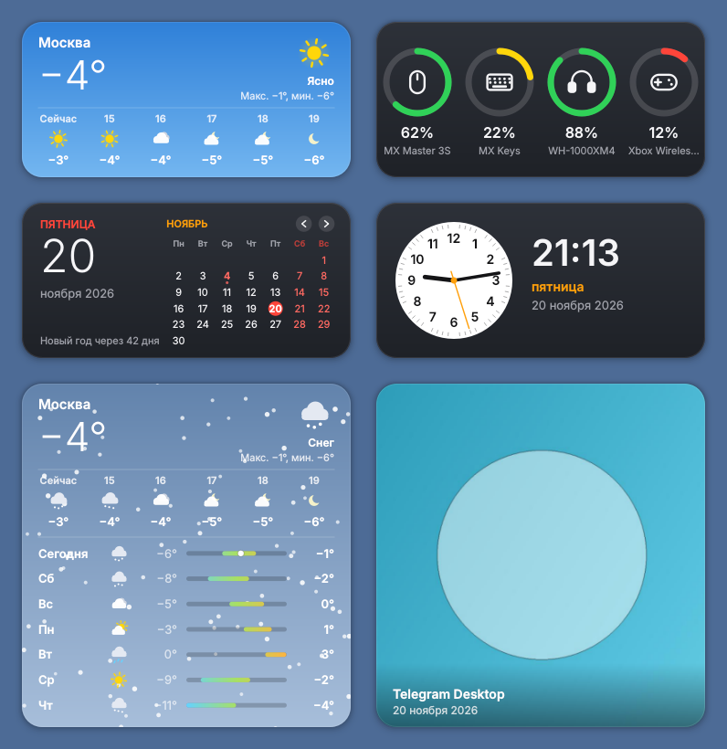
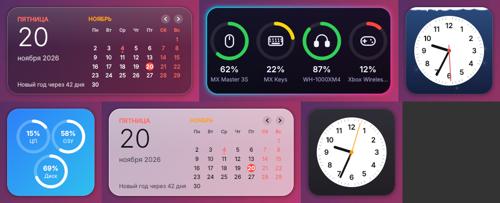

# ❄ Снег на рабочем столе (Snow Desktop)

Новогодний оверлей для **Windows и macOS**: по рабочему столу идёт снег, на окнах и панели задач / Dock
растут сугробы, горят гирлянды, под окнами висят сосульки, а раз в несколько минут проезжает
снегоуборочная машина. Работает поверх всех окон и не мешает работе: все клики проходят сквозь снег.

*A festive desktop overlay for Windows and macOS: falling snow, drifts on windows and the taskbar/Dock,
garlands, icicles, frost, a Christmas tree, blizzards and snowplows. Click-through, light on CPU.*

## Возможности

- **Снег и сугробы** — снежинки реагируют на курсор и ветер, снег копится на верхних краях окон и панели
  задач, оплывает, сползает с краёв, слетает, если резко таскать окно. Сугробы и гирлянды едут вместе
  с окном без отставания. Быстро проведи курсором через сугроб — снег разлетится.
- **Метель** — по расписанию или по кнопке: ветер, больше снега, качающиеся гирлянды.
- **Снегоуборщики** — грузовичок, трактор и роторный снегоочиститель по очереди; сгребают снег
  с панели задач и низа экрана и сносят снеговиков.
- **Украшения** — гирлянды, сосульки (падают, если дёрнуть окно), иней, ёлка с огнями.
- **Интерактив** — лепи снеговиков, давай им имена, кидай снежки.
- **Умное поведение** — прячется, когда включено полноэкранное приложение, экономит ресурсы
  на батарее и при простое, помнит снеговиков и сугробы между запусками.
- **Окно настроек** — всё настраивается ползунками.

## Установка — Windows

1. Установите [Python 3.9+](https://www.python.org/downloads/) (отметьте *Add Python to PATH*).
2. Дважды щёлкните `snow.pyw`. При первом запуске PySide6 установится сам (1–3 минуты).
   Или вручную: `pip install -r requirements.txt`.

Значок снежинки появится в трее. Готовый `.exe`: запустите `build_exe.bat` → `dist\SnowDesktop.exe`.

## Установка — macOS

Нужен Python 3.9+ ([python.org](https://www.python.org/downloads/macos/) или `brew install python`).

**Способ 1 (проще всего):** откройте Терминал в папке с файлами и выполните

```bash
python3 snow.pyw
```

При первом запуске программа сама создаст окружение в
`~/Library/Application Support/SnowDesktop/venv` и поставит PySide6 и pyobjc (2–5 минут, нужен интернет),
потом снег появится сам. В Dock значка нет — всё управление через значок ❄ в строке меню.

**Способ 2:** двойной клик по `Snow.command`. Если macOS не даёт открыть — один раз:
`chmod +x Snow.command`, затем правая кнопка → Открыть.

**Способ 3 — своё приложение `.app`:** `./build_app_mac.sh` → `dist/SnowDesktop.app`
(первый запуск: правая кнопка → Открыть, приложение не подписано).

Особенности macOS:

- Снег идёт на **основном** экране (второй монитор пока не поддерживается).
- «Панель задач» — это Dock (если он внизу); при скрытом Dock снег копится на нижнем краю экрана.
- Окно, развёрнутое зелёной кнопкой, и полноэкранные приложения: сверху на них снега нет;
  при настоящем полноэкранном режиме снег полностью прячется.
- Горячие клавиши читаются через системный опрос клавиатуры. Если они не срабатывают, откройте
  *Системные настройки → Конфиденциальность и безопасность → Мониторинг ввода* и разрешите
  Терминал (или SnowDesktop.app). Все команды в любом случае есть в меню значка ❄.
- Автозапуск при входе — галочка в настройках (создаётся LaunchAgent в `~/Library/LaunchAgents`).
- Если грузит процессор: меньше снежинок и FPS в настройках (на Mac по умолчанию 30 FPS).

## Виджеты рабочего стола (Windows 10/11)

Отдельная программа `widgets.pyw` — виджеты в стиле macOS прямо на рабочем столе:



- **Погода** — температура, прогноз по часам и на неделю. Фон меняется по погоде и времени суток,
  на нём идёт снег или дождь, сверкает гроза. Город определяется сам; поменять — правая кнопка →
  «Указать город...». Данные — [Open-Meteo](https://open-meteo.com) (бесплатно, без регистрации).
- **Батарея** — заряд мыши, клавиатуры, наушников и ноутбука (кольца, как на Mac). Работает с
  Bluetooth-устройствами и с радио-мышами **Logitech** (приёмники Unifying, Bolt, Lightspeed).
  При заряде ниже 15% приходит уведомление.
- **Фото** — слайд-шоу из папки с плавной сменой кадров и медленным приближением, как на Mac.
  Папка «Загрузки\Telegram Desktop» находится сама.
- **Календарь** — листается стрелками или колёсиком мыши, клик по названию месяца — назад
  к сегодняшнему дню. Отмечены праздники РФ.
- **Часы** — аналоговые часы с плавной секундной стрелкой (большой размер — с календарём).
- **Система** — загрузка процессора, памяти и диска.
- **Яндекс Музыка** — что играет сейчас. Пока трек играет, из обложки выезжает и крутится виниловая
  пластинка с обложкой на «яблоке», вокруг пульсирует свечение цвета обложки, а полоса прогресса —
  это «волна», которая прыгает в такт музыке (берётся настоящая громкость звука из Windows; клик по
  волне — перемотка). Если анимация не включается — правая кнопка → «Крутить пластинку всегда»,
  а «Диагностика...» покажет, что видит виджет. На паузе пластинка останавливается и уезжает обратно. Кнопки ⏮ ⏯ ⏭, колесо мыши
  листает треки. Работает с приложением и с music.yandex.ru в браузере (а также со Spotify, VK Музыкой
  и другими плеерами; Яндекс Музыка выбирается первой). Данные берутся из системного плеера Windows. Если плеер не передал обложку, виджет находит её сам:
сначала в твоих музыкальных файлах (обложка внутри MP3/FLAC/M4A или cover.jpg / folder.jpg рядом;
папки «Музыка», «Загрузки», «Рабочий стол», а свою можно добавить: правая кнопка → «Папка с моей
музыкой»), потом по названию и исполнителю в Яндекс Музыке, iTunes и Deezer. Найденное запоминается.
  Для плееров, которые сами качают треки на диск (например, mpthree), виджет берёт название,
  исполнителя и обложку из свежего файла в папке плеера, даже если плеер не сообщает трек Windows.


Виджеты плавно появляются, пружинят при нажатии, кольца и полосы заполняются с анимацией.

**Дизайн и прозрачность.** Правая кнопка → «Оформление всех виджетов»: 7 дизайнов — Тёмный,
Светлый, Стекло и Матовое стекло (размытые обои под виджетом, как в macOS), Неон (светящаяся рамка),
Яркий (свой цвет у каждого виджета), Зимний (снежная шапка и снежинки). Там же «Прозрачность»
(от непрозрачного до 70%) и «Анимации». У каждого виджета можно выбрать свой дизайн и свою
прозрачность: «Дизайн этого виджета», «Прозрачность этого виджета».



**Запуск:** двойной клик по `widgets.pyw` (или `SnowWidgets-windows.exe` из Releases, или собрать самому:
`build_widgets.bat` → `dist\SnowWidgets.exe`). Значок из четырёх квадратиков появится в трее. Если при запуске мелькает чёрное окно консоли —
значок в трее → «Ярлык на рабочем столе (запуск без консоли)» и запускай через этот ярлык.

**Управление:** перетаскивай виджет левой кнопкой (прилипает к сетке), **правая кнопка** — размер
(маленький / средний / большой, у фото ещё огромный), настройки виджета, «Добавить виджет»,
светлое/тёмное оформление, «Закрепить виджеты», «Поверх всех окон». Виджеты живут под окнами, как на
рабочем столе, и всплывают, когда нажимаешь Win+D. Автозапуск — галочка в меню значка в трее.
Расположение хранится в `%APPDATA%\SnowWidgets\widgets.json`.

**Фото из Telegram.** Telegram Desktop сохраняет файлы в `Загрузки\Telegram Desktop` — эта папка
есть в списке правая кнопка → «Откуда брать фото». Если нужной папки там нет — «Другая папка...»
(в окне выбора папки сами фото не видны, так и должно быть) или «Выбрать отдельные фото...».
Фото, которые ты только открывал в Telegram, но не сохранял, лежат во внутреннем кэше программы:
сначала сохрани их (правая кнопка по фото → «Сохранить как»). Стикеры и картинки меньше 200 px
пропускаются.

**Про заряд мыши.** Показывается заряд Bluetooth-устройств (то, что видно в *Параметры → Bluetooth*)
и мышей Logitech и Razer на радио-приёмнике — их программа опрашивает сама (Logitech — по протоколу HID++, Razer — по протоколу OpenRazer)
(напрямую через системные библиотеки Windows — ничего ставить не нужно). Кроме того, виджет читает стандартное поле HID «заряд батареи», которое сообщают
многие беспроводные мыши без фирменного протокола. Мыши других фирм с USB-приёмником (SteelSeries,
Redragon, A4Tech, Defender, безымянные 2.4 ГГц и т.п.) либо вообще не сообщают заряд компьютеру,
либо отдают его только своей фирменной программе — для них виджет заряд показать не сможет, но
напишет, какая мышь подключена (правая кнопка → «Какие мыши видит программа»).
Данные обновляются раз в полторы минуты (или «Обновить сейчас» в меню виджета).

## Горячие клавиши

Работают везде. Все — с **Ctrl+Shift**:

| Действие | Windows | macOS |
|---|---|---|
| окно настроек | `F1` | `S` |
| вызвать снегоуборщик | `F2` | `B` |
| метель вкл/выкл | `F3` | `W` |
| режим снежков | `F10` | `T` |
| опережение сугробов при таскании окон: больше / меньше | `F7` / `F8` | `]` / `[` |
| лепить снеговика | `Y` | `Y` |
| стряхнуть снег с окон | `C` | `C` |
| пауза | `P` | `P` |
| выход | `Q` | `Q` |

**Как лепить снеговика:** включи режим лепки, зажми левую кнопку и води мышкой (снежок растёт),
отпусти над окном или панелью задач — шар упадёт на верхний край. Следующие шары отпускай над
снеговиком (всего 3). Средняя кнопка по снеговику — дать имя, правая — убрать, `Esc` — выйти.

## Где хранятся данные

- Windows: `%APPDATA%\SnowDesktop\`
- macOS: `~/Library/Application Support/SnowDesktop/`

Внутри: `settings.json`, `state.json` (снеговики и сугробы), логи (`snow_error.log`, `snow_freeze.log`).
Чтобы сбросить всё, закройте программу и удалите папку.

## Если что-то не так

- **Снег зависает или пропадает на полном экране.** Пришлите `snow_freeze.log` из папки данных.
  Определение полного экрана можно выключить в настройках («Система»).
- **Гирлянда отстаёт от окна или убегает вперёд.** Подстройте опережение (см. таблицу клавиш).
- **Mac: снега нет, но значок в строке меню есть.** Откройте `snow_error.log` в папке данных.
- **Антивирус ругается на `.exe`.** Это обычная история для программ, собранных PyInstaller, которые
  рисуют поверх окон. Исходный код открыт, можно запускать `snow.pyw` напрямую.

